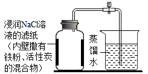

# Chemistry - 题目 342

**ID**: ba41c6ee86a64ca4952086a86c48afff
**年级**: Grade 9
**难度**: Medium-Hard
**题型**: Scientific Inquiry

## 题目
小亮同学发现实验室利用红磷燃烧测定空气中氧气含量，实验结果并不准确。​​​​​​​‌为什么呢？（进行猜想）（1）装置漏气；（2），导致装置内有氧气剩余。（实验与交流）在老师的指导下，小亮分别用过量的红磷和白磷进行实验，用测氧气浓度的传感器测得反应后装置内氧气的浓度分别为8.84%和3.21%，请问产生上述结果的原因可能是：。（再探究）小亮查阅资料发现铁粉在潮湿的空气中易生锈（Fe_{2}O_{3}﹒xH_{2}O）,利用铁粉、活性炭、氯化钠等物质又进行了实验（如图），实验后测得的数据如下表：实验前体积实验后体积集气瓶内空气烧杯内蒸溜水烧杯内剩余蒸溜水131mL90.0mL63.6mL计算出空气氧气体积含量为（计算结果保留一位小数）（结论与反思）通过上述实验探究，选择（填物质名称）进行实验，可减小实验误差。（拓展延伸）铜也能与空气中的氧气、水、二氧化碳反应而锈蚀生成铜绿[主要成分为Cu_{2}(OH)_{2}CO_{3}],若将上图实验中的铁粉换成铜粉进行实验，请判断能否较准确的测定空气中氧气的含量，并说明理由：。

## 解答

1. [进行猜想]红磷量不足，不能将集气瓶中的氧气消耗完，导致装置内会有氧气剩余。故填：红磷量不足。
2. [实验与交流]物质的种类不同，相同条件下，燃烧需要的氧气最低浓度不同，从装置中剩余氧气浓度分析，红磷燃烧需要的最低氧气浓度比白磷高，白磷更易燃烧，消耗的氧气更多。故填：相同条件下，白磷在空气中充分燃烧所需的最低氧气浓度低，耗氧量更多。
3. [再探究]氧气被消耗的体积等于烧杯中蒸馏水减少的体积，根据表中数据可计算：90mL-63.6mL=26.4mL，空气氧气体积含量为： $\frac {26.4{\rm{m}}{\rm{L}}}{131{\rm{m}}{\rm{L}}}\times 100{\rm{\%}}\approx 20.2{\rm{\%}}$ 。故填：20.2%。
4. [结论与反思]选择铁粉、活性炭、氯化钠等物质或白磷燃烧法进行探究实验，消耗的氧气更多，结果更准确。故填：铁粉、活性炭、氯化钠和蒸馏水（或白磷）。
5. [拓展延伸]不能，因为利用铜粉锈蚀不仅需要消耗空气中的氧气还要消耗二氧化碳，而且空气中只有约0.03%的二氧化碳，含量较少，不能将装置中的氧气完全消耗，从而使测量结果不准确。

## 知识点

**中文**:
  - 测定空气里氧气含量的探究

**English**:
  - Inquiry into Oxygen Content in Air

---
