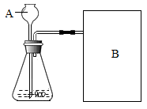

# Chemistry - 题目 78

**ID**: c23cf1e2fa2145169acf58e41d893dd0
**年级**: Grade 9
**难度**: Medium-Hard
**题型**: Scientific Inquiry

## 题目
研究性学习小组选择“H_{2}O_{2}生成O_{2 }的快慢与什么因素有关”的课题进行探究，以下是他们探究的主要过程：〖假设〗H_{2}O_{2 }生成O_{2}的快慢与催化剂种类有关。​​​​​​​‌〖实验方案〗常温下，在两瓶同质量，同浓度的H_{2}O_{2}溶液中，分别加入相同质量的MnO_{2 }和水泥块，测量各生成一瓶（相同体积）O_{2}所需的时间。〖进行实验〗(1)下图是他们进行实验的装置图，气体发生装置中A仪器名称是，在此实验中B处宜采用的气体收集方法是。〖实验记录〗如表格所示实验编号12反应物5%H_{2}O_{2}5%H_{2}O_{2}催化剂1g水泥块1gMnO_{2}时间165秒46秒〖结论〗(2)该探究过程得出的结论是：。〖反思〗(3)H_{2}O_{2}在常温下分解缓慢，加入MnO_{2}或水泥块后反应明显加快，若要证明MnO_{2}和水泥块是该反应的催化剂，还需要增加实验来验证它们在化学反应前后的和是否改变。(4)H_{2}O_{2}生成O_{2 }的快慢与哪些因素有关？请你帮助他们继续探究。（只要求提出一种影响H_{2}O_{2 }生成O_{2 }的快慢的因素以及相关假设和实验方案）：假设：；方案：。

## 解答

1. （1）
2. 据图可知，装置中A仪器名称是锥形瓶；
3. （2）
4. 该探究过程中，利用二氧化锰反应收集相等体积的氧气时需要时间比利用水泥块短，得出的结论是在相同条件下，产生氧气的快慢与催化剂种类有关；
5. （3）
6. 催化剂能够改变反应速率，反应前后质量和化学性质都不变；
7. （4）
8. H_{2}O_{2}生成O_{2}的快慢与H_{2}O_{2}质量分数有关；实验方案：同温下取2份质量相等、浓度不同的H_{2}O_{2}溶液，分别加入质量相等的同种催化剂，测量收集相同体积的气体所需的时间，结果质量分数大的过氧化氢溶液生成的氧气快，先收集满集气瓶。

## 知识点

**中文**:
  - 影响化学反应速率的因素探究
  - 过氧化氢制取氧气

**English**:
  - Inquiry into Factors Affecting Reaction Rate
  - Preparation of Oxygen using Hydrogen Peroxide

---
