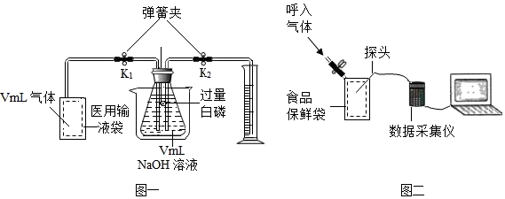
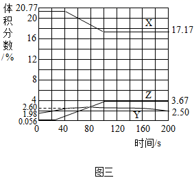

# Chemistry - 题目 293

**ID**: ced92f03461d43c0ba69711cd180e581
**年级**: Grade 9
**难度**: Medium-Hard
**题型**: Scientific Inquiry

## 题目
某学习小组对人体吸入的空气与呼出的气体，进行了如下探究。​​​​​​​‌实验一：（提出问题）人体吸入的空气与呼出的气体组成有什么不同?（查阅资料）（1）白磷的着火点为40℃。（2）通常条件下，白磷与氢氧化钠溶液不反应。（3）通常条件下，氢氧化钠溶液易与二氧化碳反应生成可以溶于水的碳酸钠和水。（实验操作、记录、分析）（1）先检查装置的，装入试剂，在医用输液袋中装入V mL气体，连接装置。（2）打开弹簧夹K_{1}、K_{2}，缓慢将袋中的气体全部排出。读出量筒中液体体积V_{1 }mL，锥形瓶中氢氧化钠溶液的作用是。（3）关闭弹簧夹K_{1}、K_{2}，再（填操作方法），以促使白磷迅速燃烧，写出磷（P）燃烧的符号表达式。待瓶中气体冷却至室温，打开K_{2}，读出量筒中液体体积为V_{2 }mL，其数值等于已反应的之外的气体总体积。实验二：（4）如图二，把测量氧气、二氧化碳、水蒸气（测湿度）的探头放入袋中，开始采集数据，然后向袋内呼出气体。采集的数据经处理如图三，表示二氧化碳体积分数变化的是（填“X”、“Y”、“Z”）。（数据处理）（5）实验一中，二氧化碳的体积分数表达式是（用百分数表示，下同），氧气的体积分数表达式是。（6）实验二中，200 s时没有采集数据的所有气体的总体积分数为。（评价与反思）（7）有人认为教材中空气成分的“其它气体和杂质”主要是指水蒸气，由实验二判断此说法是错误的，理由是。

## 解答

1. [实验操作、记录、分折]（1）实验过程中要保证装置的密封，实验前应先检查装置的气密性；
2. （2）氢氧化钠溶液易与二氧化碳反应生成可以溶于水的碳酸钠和水，锥形瓶中氢氧化钠溶液的作用是吸收气体中的二氧化碳，利用减少的液体体积测出二氧化碳的含量；
3. （3）要使白磷迅速燃烧，可向烧杯中加入热水（热水温度大于40°C），磷燃烧的符号表达式为P+O_{2}$\begin{array}{}\underset\longrightarrow {点燃}\\\;\end{array}$ P_{2}O_{5}。待瓶中气体冷却至室温，打开K_{2}。量筒中的水倒吸，读出量筒中液体体积为V_{2}mL。其数值等于已反应的氧气和二氧化碳之外的气体总体积；
4. （4）由于呼出气体中二氧化碳增多和水蒸气增多，氧气减少， Y的体积分数在60s后逐渐减小的原因是水蒸气冷凝，故Y表示的是水蒸气，所以表示二氧化碳体积分数变化的是Z；
5. [数据处理]（5）实验一中，二氧化碳的体积为VmL-V_{1}mL，体积分数表达式是： $\frac {{\rm{V}}-{\rm{V}}_{{\rm{1}}}}{{\rm{V}}}{\rm{×}}{\rm{1}}{\rm{0}}{\rm{0}}％$ ；氧气的体积为V_{1}mL-V_{2}mL；体积分数表达式是： $\frac {{\rm{V}}_{{\rm{1}}}-{\rm{V}}_{{\rm{2}}}}{{\rm{V}}}{\rm{×}}{\rm{1}}{\rm{0}}{\rm{0}}％$ ；
6. （6）由图示可知：200s时未采集数据的所有气体，总体积分数为1-17.17%-3.67%-2.50%=76.66%；
7. [评价与反思]：（7）由实验2可知，空气中水的体积分数为1.98%，而空气成分的气体杂质体积分数为0.03%，所以空气成分的“其它气体和杂质”主要是指水蒸气错误。

## 知识点

**中文**:
  - 吸入空气与呼出气体的比较

**English**:
  - Comparison of Inhaled and Exhaled Air

---
