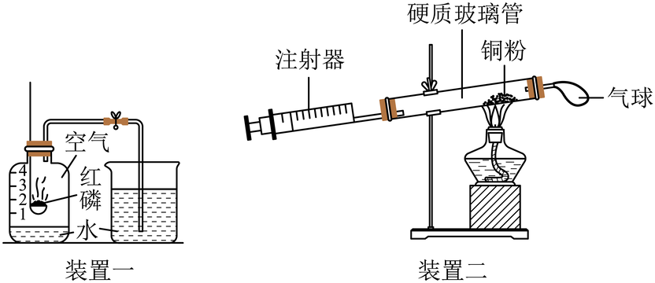

# Chemistry - 题目 183

**ID**: e6a075390c3748349df6367800e7edd3
**年级**: Grade 9
**难度**: Medium-Hard
**题型**: Scientific Inquiry

## 题目
化学兴趣小组设计了测定空气中氧气含量的两套实验装置，请结合图示回答问题。​​​​​​​‌【实验一】用装置一测定空气中氧气含量。点燃燃烧匙内的红磷，立即伸入集气瓶中并塞紧瓶塞。待燃烧停止并冷却后，打开止水夹，发现水被吸入集气瓶中，且约占瓶中空气总体积的 ${\rm \frac {1}{5}}$ 。【交流讨论】 根据装置一的实验现象，可以得到的结论有、（答两点）。【实验二】经过向老师请教并查阅资料后，同学们初步了解了红磷燃烧的生成物会污染环境，决定改用装置二来进行实验探究。【反思交流】 （1）写出装置二实验过程中硬质玻璃管内的现象，该反应的文字表达式为，该装置中气球的作用是。（2）利用装置二进行实验，记录数据如下：盛有铜粉的仪器中空气体积反应前注射器中空气体积反复推拉注射器，当气球恢复原状时，停止推拉并熄灭酒精灯。观察注射器中气体体积20mL14mL8mL分析数据，实验测得空气中氧气的体积分数是（结果保留到一位小数），实验测得的结果出现偏差的原因可能是（答一点）。【拓展提升】（1）装置一和装置二相比，更环保的是。（2）查阅资料：镁+氧气 ${\rm {\xrightarrow[~\;~]{~{点燃}~}}}$ 氧化镁；镁+氮气 ${\rm {\xrightarrow[~\;~]{~{点燃}~}}}$ 氮化镁：根据提供的资料回答下列问题，请问镁条能否用来代替红磷测定空气中氧气的含量（填“能”或“不能”），原因是。

## 解答

1. [交流讨论]
2. 根据装置一的实验现象，可得出氧气约占空气体积的五分之一，氮气约占空气总体积的五分之四，氮气不可燃也不助燃，氮气不易溶于水等。
3. [反思交流]
4. （1）铜加热生成氧化铜，氧化铜为黑色固体，则现象为红色粉末变成黑色，文字表达式为 ${\rm 铜+氧气{\xrightarrow []{点燃}}氧化铜}$ ；由于反应放热，则装置中气球的作用为平衡气压。
5. （2）根据数据，可知空气中氧气的体积分数是 ${\rm \frac {14{\rm mL}-8{\rm mL}}{20{\rm mL}+14{\rm mL}}\times 100\%\approx 17.6\%}$ ；测定结果偏小，可能原因为：铜粉少量，氧气没有完全消耗，或装置气密性不好，或观察读数时没有冷却至室温等。
6. [拓展提升]
7. （1）装置二为密闭装置，更环保。
8. （2）由于条不仅能和空气中的氧气反应，还能与空气中的氮气发生反应，会使得测得的氧气的体积偏大，则不能用镁条代替红磷测定空气中氧气的含量。

## 知识点

**中文**:
  - 测定空气中氧气含量的装置改进
  - 测定空气里氧气含量的探究

**English**:
  - Apparatus Improvement for Measuring Oxygen Content
  - Inquiry into Oxygen Content in Air

---
