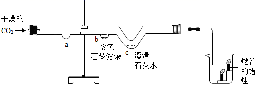
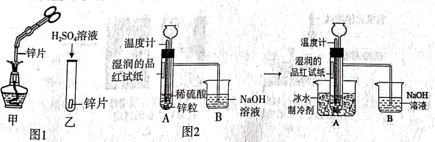

# Chemistry - 题目 134

**ID**: e7220e8c6445431183690fed881fca9a
**年级**: Grade 9
**难度**: Medium-Hard
**题型**: Scientific Inquiry

## 题目
(一)探究二氧化碳的性质（提出问题）二氧化碳有哪些性质呢？（实验探究）如图所示，组装好仪器装置，检查装置的气密性后装入药品，进行实验。​​​​​​​‌（实验结论）根据烧杯中的实验现象能得出的结论为。（交流研讨）该实验的不足之处是不能充分证明二氧化碳与水能发生反应，在不改变实验装置的情况下你的改进方法是。(二)探究金属锌的性质（1）如图甲所示，将锌片在酒精灯上灼烧，发现熔化了的锌并未掉下来，包裹在一个“小袋子”中，下面分析正确的是(填序号)①氧化锌的熔点比锌高           ②“小袋子”是致密的氧化锌薄膜③锌与氧气反应生成氧化锌       ④锌的抗腐蚀性高（2）用图乙所示实验探究锌的性质时，闻到有刺激性气味。（提出问题）为什么会有刺激性气味？（查阅资料）① ${\rm{Z}}{\rm{n}}{\rm{+}}{\rm{2}}{\rm{H}}_{{\rm{2}}}{\rm{S}}{\rm{O}}_{{\rm{4}}}（浓）{\rm{=}}{\rm{Z}}{\rm{n}}{\rm{S}}{\rm{O}}_{{\rm{4}}}{\rm{+}}{\rm{S}}{\rm{O}}_{{\rm{2}}}\uparrow {\rm{+}}{\rm{2}}{\rm{H}}_{{\rm{2}}}{\rm{O}}$  ；②SO_{2}有刺激性气味，化学性质与CO_{2}相似，但SO_{2}能使品红褪色，CO_{2}不能；③NaOH溶液能吸收有毒的SO_{2}（猜想与假设）①刺激性气味产生可能与硫酸浓度大有关；②刺激性气味产生可能与反应放热，温度升高有关（设计实验）为探究猜想的正确性，同学们设计了以下实验，请你参与他们的探究过程。利用如图2所示装置进行实验，并记录实验结果于下面的表格中。浓度现象条件①40%的H_{2}SO_{4}溶液②20%的H_{2}SO_{4}溶液自然温度试纸褪色液体温度升高至42℃试纸颜色不变液体温度升高至28℃冰水冷却试纸颜色变浅液体温度为12℃试纸颜色不变液体温度为12℃写出20%的硫酸与锌反应的化学方程式。（解释与结论）①由上述实验得出，产生的刺激性气味与温度的关系是。②小丽得出结论，刺激性气味产生与硫酸浓度有关，依据是。（反思与评价）在上述设计中，除温度和浓度外，还应该控制的因素是。

## 解答

1. [实验结论]
2. 烧杯中的实验现象是蜡烛由下向上依次熄灭，能得出的结论为二氧化碳密度比空气大，不燃烧也不支持燃烧，故填：二氧化碳密度比空气大，不燃烧也不支持燃烧。
3. [交流研讨]
4. a处放干燥石蕊试纸，b处放湿润的石蕊试纸，通入二氧化碳后，a处试纸不变色，b处试纸变红色，说明二氧化碳能和水反应，故填：a处放干燥石蕊试纸，b处放湿润的石蕊试纸。
5. (二)探究金属锌的性质
6. （1）①锌和氧气反应生成氧化锌，熔化了的锌并未掉下来，包裹在一个“小袋子”中说明氧化锌的熔点比锌高，正确。
7. ②“小袋子”是致密的氧化锌薄膜，正确。
8. ③锌与氧气反应生成氧化锌，正确。
9. ④氧化锌可以隔绝氧气，锌的抗腐蚀性高，正确。
10. 故选：①②③④。
11. [设计实验]
12. 20%的硫酸与锌反应，试纸颜色不变，说明没有生成二氧化硫，只生成了硫酸锌和氢气，化学方程式，故填：H_{2}SO_{4}+Zn=ZnSO_{4}+H_{2}↑。
13. [解释与结论]
14. ①自然温度下，40%的H_{2}SO_{4}溶液，试纸褪色说明生成二氧化硫多，气味浓，冰水冷却试纸颜色变浅，说明生成二氧化硫少，气味浅，故填：温度越高，刺激性气味越浓。
15. ②自然温度下，40%的H_{2}SO_{4}溶液，试纸褪色说明生成二氧化硫多，20%的H_{2}SO_{4}溶液，试纸颜色不变，生成二氧化硫少，说明刺激性气味产生与硫酸浓度有关，故填：自燃温度下，40%的H_{2}SO_{4}溶液，试纸褪色说明生成二氧化硫多，20%的H_{2}SO_{4}溶液，试纸颜色不变，生成二氧化硫少。
16. [反思与评价]
17. 在上述设计中，除温度和浓度外，还应该控制的因素是酸的用量等，故填：酸的用量等。

## 知识点

**中文**:
  - 不燃烧也不支持燃烧
  - 实验探究物质的性质或变化规律
  - 实验探究物质变化的条件和影响物质变化的因素
  - 二氧化碳与水的反应
  - 二氧化碳与碱的反应
  - 金属的物理性质
  - 金属与氧气反应
  - 金属与酸反应

**English**:
  - Non-combustible and Non-supporting Combustion
  - Inquiry into Properties or Change Rules of Matter
  - Inquiry into Conditions and Factors of Material Change
  - Reaction of Carbon Dioxide with Water
  - Reaction of Carbon Dioxide with Alkali
  - Physical Properties of Metals
  - Reaction of Metals with Oxygen
  - Reaction of Metals with Acids

---
