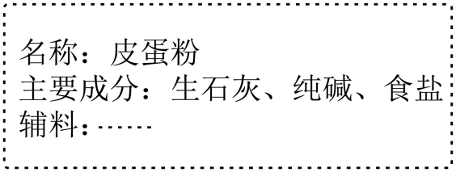

# Chemistry - 题目 63

**ID**: f5eed237fbf541ae9d7e91e81709977d
**年级**: Grade 9
**难度**: Medium-Hard
**题型**: Scientific Inquiry

## 题目
皮蛋是一种大众喜爱的传统美食，皮蛋粉是制作皮蛋的原料之一，其部分说明书如图所示。​​​​​​​‌利用皮蛋粉经调料、裹蛋、密封等工序，即可制得皮蛋。化学小组同学围绕“皮蛋的制作”进行了如下活动。活动一：认识皮蛋粉(1)皮蛋粉主要成分均为初中化学常见物质，下列各组化学名称与皮蛋粉的主要成分对应正确的是（选填字母）。

## 解答

1. （1）皮蛋粉的主要成分为生石灰、纯碱、食盐，生石灰是氧化钙的俗称，纯碱是碳酸钠的俗称，食盐的主要成分是氯化钠，故选：C；
2. （2）调制过程中会有发热现象，这是因为氧化钙（生石灰）与水反应生成氢氧化钙，该反应放热，化学方程式为： ${\rm {\rm{C}}{\rm{a}}{\rm{O}}+{\rm{H}}{{}_{{{2}}}}{\rm{O}}{\rm{=}}{\rm{C}}{\rm{a}}\left ({{\rm{O}}{\rm{H}}}\right ){{}_{{{2}}}}}$ ；
3. （3）因为皮蛋粉中生石灰与水反应生成氢氧化钙，氢氧化钙可与碳酸钠（纯碱）反应生成氢氧化钠和碳酸钙沉淀，故皮蛋液中一定含有氢氧化钠，此外，由于氯化钠与其他物质间不具备发生复分解反应的条件，因此皮蛋液中也一定含有氯化钠；故皮蛋液中一定含有的两种溶质是NaOH、NaCl；
4. （4）由于氢氧化钙微溶于水，则白色沉淀可能是氢氧化钙，所以不能得出“皮蛋液中含有碳酸钠”的结论；
5. （5）用试剂X替代氯化钙溶液重新进行实验，依据现象Y得出“皮蛋液中含有碳酸钠”的结论，因为皮蛋液中已存在氢氧化钠，为排除氢氧化钠的干扰，试剂X应为足量的稀盐酸，稀盐酸和碳酸钠反应生成氯化钠、二氧化碳和水，观察到现象Y为有气泡产生，则说明皮蛋液中含有碳酸钠；
6. （6）由于皮蛋液中含有氢氧化钠，二氧化碳能与氢氧化钠反应生成碳酸钠和水，因此浸制皮蛋时容器需“密封”，目的是防止空气中的二氧化碳与皮蛋液中的溶质反应，影响浸制效果；
7. （7）皮蛋中除水外含量最多的基本营养素是蛋白质。

## 知识点

**中文**:
  - 物质的名称与俗称
  - 碱的化学性质
  - 盐的化学性质
  - 生石灰的性质与用途

**English**:
  - Scientific and Common Names of Substances
  - Chemical Properties of Bases
  - Chemical Properties of Salts
  - Properties and Uses of Quicklime

---
