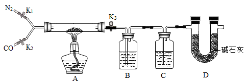

# Chemistry - 题目 70

**ID**: 205dd0d87d654943a1ad96554ed8b52f
**年级**: Grade 9
**难度**: Medium-Hard
**题型**: Short Answer

## 题目
实验室现有一瓶含少量水和铜粉的碱式碳酸铜样品，为测定其中碱式碳酸铜的质量分数并回收铜粉，某化学兴趣小组利用下图所示装置进行实验。​​​​​​​‌（该装置气密性良好，装置B、C中所装药品均足量，碱石灰是氧化钙和氢氧化钠的混合物，尾气经过收集处理，不考虑气体经过溶液时带走水蒸气的情况）已知：（1）碱式碳酸铜受热分解的化学方程式为 ${\rm{C}}{\rm{u}}_{{\rm{2}}}{\rm{(}}{\rm{O}}{\rm{H}}{\rm{)}}_{{\rm{2}}}{\rm{C}}{\rm{O}}_{{\rm{3}}}\begin{array}{}{\underline{\underline {\rm{Δ}}}}\\\;\end{array}{\rm{2}}{\rm{C}}{\rm{u}}{\rm{O}}{\rm{+}}{\rm{H}}_{{\rm{2}}}{\rm{O}}{\rm{+}}{\rm{C}}{\rm{O}}_{{\rm{2}}}\uparrow $ 。（2）装置A中硬质玻璃管的质量为m1。部分实验步骤如下：Ⅰ、关闭弹簧夹K2、打开K1和K3，通入一段时间氮气，关闭K1和K3。分别称量、记录装置B、C的质量（包含药品），按图示顺序连接好实验装置。Ⅱ、打开弹簧夹K3，给碱式碳酸铜样品加热，待硬质玻璃管中固体质量不再发生变化时，停止加热，并打开K1通入氮气直至装置冷却至室温。Ⅲ、关闭K1和K3，称量、记录A中硬质玻璃管和剩余固体的总质量，分别称量、记录装置B、C增加的质量。Ⅳ、连接好装置后继续进行实验。打开K2和K3，通入CO一段时间后，点燃A处的酒精灯。待硬质玻璃管中固体恒重，熄灭酒精灯，关闭K2，打开K1继续通入氮气直至硬质玻璃管冷却至室温。称量、记录装置B、C再次增加的质量，以及硬质玻璃管和剩余固体的总质量。实验数据记录如下表：步骤Ⅲ中硬质玻璃管和剩余固体步骤Ⅲ中装置B增加的质量步骤Ⅲ中装置C增加的质量步骤Ⅳ中装置B再次增加的质量步骤Ⅳ中装置C再次增加的质量步骤Ⅳ中硬质玻璃管和剩余固体的总质量质量m2m3m40m5m6请回答下列问题：(1)装置C中的药品是。(2)步骤Ⅳ中硬质玻璃管里发生的化学反应方程式为。(3)该样品中碱式碳酸铜的质量分数为（用m1～m4中相关数据的代数式表示）。若没有装置D，样品中最终回收铜粉的质量测量结果将（填“偏大”“偏小”或“不变”）。(4)有关样品，下列说法正确的是（填字母标号）。A．样品中铜粉的质量为m2-m6

## 解答

1. （1）步骤Ⅳ发生的是一氧化碳还原氧化铜生成二氧化碳，测定装置B增重为0，而C装置质量增加，说明C装置是吸收二氧化碳的装置，则装置C中的药品是氢氧化钠溶液；
2. （2）步骤Ⅳ中硬质玻璃管里发生的是一氧化碳还原氧化铜，化学方程式为 $CO+CuO\begin{array}{}{\underline{\underline {\,Δ\,}}}\\\;\end{array}CO_{2}+Cu$ ；
3. （3）步骤Ⅲ中硬质玻璃管和剩余固体为氧化铜和铜的混合物，总质量为m2，样品中的水和碱式碳酸铜分解生成的水全部被B吸收，两部分水的质量为m3， 步骤Ⅲ中装置C增加的质量m4为碱式碳酸铜分解生成的二氧化碳的质量，则样品的总质量为m2+m3+m4-m1；设碱式碳酸铜的质量为 $x$  $\begin{array}{}{\rm{C}}{\rm{u}}_{{\rm{2}}}{\rm{(}}{\rm{O}}{\rm{H}}{\rm{)}}_{{\rm{2}}}{\rm{C}}{\rm{O}}_{{\rm{3}}}\\222\\x\end{array}\begin{array}{}\begin{array}{}{\underline{\underline {\rm{Δ}}}}\\\;\end{array}\\\\\;\end{array}\begin{array}{}2CuO+\\\\\;\end{array}\begin{array}{}{\rm{H}}_{{\rm{2}}}{\rm{O}}+\\\\\;\end{array}\begin{array}{}CO_{{\rm{2}}}\uparrow \\44\\{\rm{m}}_{4}\end{array}\frac {222}{44}=\frac {x}{{\rm{m}}_{4}}x=\frac {111{\rm{m}}_{4}}{22}$
4. 故该样品中碱式碳酸铜的质量分数为 $\frac {\frac {111{\rm{m}}_{4}}{22}}{{\rm{m}}_{2}+{\rm{m}}_{3}+{\rm{m}}_{4}-{\rm{m}}_{1}}\times 100\%=\frac {111{\rm{m}}_{4}}{22\left ({{\rm{m}}_{2}+{\rm{m}}_{3}+{\rm{m}}_{4}-{\rm{m}}_{1}}\right )}\times 100\%$ ;若没有装置D，空气中的二氧化碳会进入装置C，导致二氧化碳的质量增大，从而碱式碳酸铜的质量增大，则样品中最终回收铜粉的质量测量结果将偏大；
5. （4）A、m2是玻璃管、铜和氧化铜的质量，m6是玻璃管个和铜的质量，m2-m6为氧化铜中氧元素的质量，A错误；B、实验过程中生成二氧化碳的质量为m4+m5，B错误；C、设碱式碳酸铜分解生成水的质量为a， $\begin{array}{}{\rm{C}}{\rm{u}}_{{\rm{2}}}{\rm{(}}{\rm{O}}{\rm{H}}{\rm{)}}_{{\rm{2}}}{\rm{C}}{\rm{O}}_{{\rm{3}}}\\\\\;\end{array}\begin{array}{}\begin{array}{}{\underline{\underline {\rm{Δ}}}}\\\;\end{array}\\\\\;\end{array}\begin{array}{}2CuO+\\\\\;\end{array}\begin{array}{}{\rm{H}}_{{\rm{2}}}{\rm{O}}+\\18\\{\rm{a}}\end{array}\begin{array}{}CO_{{\rm{2}}}\uparrow \\44\\{\rm{m}}_{4}\end{array}\frac {18}{44}=\frac {{\rm{a}}}{{\rm{m}}_{4}}{\rm{a}}=\frac {9{\rm{m}}_{4}}{22}$
6. 故样品中水的质量为 m3- $\frac {9{\rm{m}}_{4}}{22}$ ，C错误；D、m6是硬质玻璃管和铜的质量，最后硬质玻璃管的质量为m1，则样品中铜元素的质量为m6-m1，D正确；E、氧化铜钟氧元素的质量为m2-m6，与一氧化碳还原氧化铜生成的二氧化碳中的氧元素的质量 $\frac {4{\rm{m}}_{5}}{11}$ ,样品中氧元素的质量为 $\frac {8{\rm{m}}_{3}}{9}$ ，步骤步骤Ⅲ中装置C增加的质量m4为碱式碳酸铜分解生成的二氧化碳的质量，氧元素的质量为 $\frac {8{\rm{m}}_{4}}{11}$ ，故样品中氧元素的质量可表示为 ${\rm{m}}_{{\rm{2}}}{\rm{-}}{\rm{m}}_{{\rm{6}}}+\frac {{\rm{8}}{\rm{m}}_{{\rm{3}}}}{{\rm{9}}}{\rm{+}}\frac {{\rm{8}}{\rm{m}}_{{\rm{4}}}}{{\rm{1}}{\rm{1}}}$ 或 $\frac {{\rm{8}}{\rm{m}}_{{\rm{3}}}}{{\rm{9}}}{\rm{+}}\frac {{\rm{8}}{\rm{m}}_{{\rm{4}}}}{{\rm{1}}{\rm{1}}}{\rm{+}}\frac {{\rm{4}}{\rm{m}}_{{\rm{5}}}}{{\rm{1}}{\rm{1}}}$ ，E正确。故选DE。

## 知识点

**中文**:
  - 其他金属的冶炼
  - 实验探究物质的组成成分以及含量

**English**:
  - Smelting of Other Metals
  - Inquiry into Composition and Content of Matter

---
