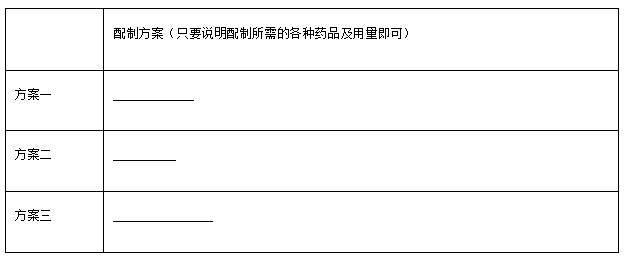

# Chemistry - 题目 120

**ID**: 74782ee587b94f81927ba8a7e541c7d4
**年级**: Grade 9
**难度**: Medium-Hard
**题型**: Short Answer

## 题目
实验室配制50g质量分数为20%的硝酸钾溶液，现有25g溶质质量分数为40%的硝酸钾溶液、20g溶质质量分数为15%的硝酸钾溶液及足量的硝酸钾固体和水，请选用上述药品设计三种配制方案，并填入下表：​​​​​​​‌

## 解答

1. 方案一：取硝酸钾固体溶于水，需要硝酸钾固体的质量=50g×20%=10g，需要水的质量=50g﹣10g=40g；
2. 方案二：取40%的硝酸钾溶液加水稀释，因为要配制的50g质量分数为20%的硝酸钾溶液中含硝酸钾10g，则需要40%的硝酸钾溶液的质量= $\frac {{\rm{1}}{\rm{0}}{\rm{g}}}{{\rm{4}}{\rm{0}}{\rm{\%}}}{\rm{=}}{\rm{2}}{\rm{5}}{\rm{g}}$ ，需要加水的质量=50g﹣25g=25g；
3. 方案三：假设取15%的硝酸钾溶液继续溶解硝酸钾，20g溶质质量分数为15%的硝酸钾溶液含硝酸钾的质量=20g×15%=3g，而配制50g质量分数为20%的硝酸钾溶液需要硝酸钾固体的质量=50g×20%=10g，因此还需要加入10g﹣3g=7g硝酸钾固体，还需要加入水的质量=50g﹣20g﹣7g=23g。

## 知识点

**中文**:
  - 溶液的浓缩与稀释
  - 配制一定溶质质量分数的溶液

**English**:
  - Concentration and Dilution of Solutions
  - Preparation of Solutions with Specific Mass Fraction

---
