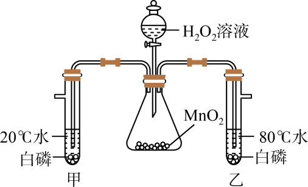

# Chemistry - 题目 51

**ID**: 310e2f2a509342ea8febe0d460dcadfa
**年级**: Grade 9
**难度**: Medium
**题型**: Multiple-choice

## 题目
用下图装置验证燃烧的条件(已知白磷的着火点为40℃)，实验现象记录如下。​​​​​​​‌下列说法不正确的是（      ）甲中白磷乙中白磷滴入H_{2}O_{2}溶液前①不燃烧②不燃烧滴入H_{2}O_{2}溶液后③不燃烧④燃烧

## 解答

1. A、②中的白磷的温度为80℃高于40℃，但没有加入过氧化氢溶液，不生成氧气，即白磷不与氧气接触，白磷不燃烧，④中的白磷的温度为80℃高于40℃，加入过氧化氢溶液，生成氧气，即白磷与氧气接触，白磷燃烧，所以对比②④，可验证白磷燃烧需要与氧气接触，选项正确；
2. B、①中的白磷的温度为20℃，低于40℃，且没有加入过氧化氢溶液，不生成氧气，白磷不燃烧，④中的白磷的温度为80℃高于40℃，加入过氧化氢溶液，生成氧气，即白磷与氧气接触，白磷燃烧，两个实验中的变量是温度与氧气，则对比①④，不能验证白磷燃烧需要温度达到白磷的着火点，选项错误；
3. C、乙中白磷的温度高于40℃，若将乙中的水全部倒出，空气进入管内，即白磷与氧气接触，则白磷立即燃烧，选项正确；
4. D、实验中的水可以隔绝氧气、提供热量，选项正确；
5. 故选B。

## 知识点

**中文**:
  - 燃烧条件与灭火原理探究

**English**:
  - Inquiry into Combustion Conditions and Extinguishing Principles

---
