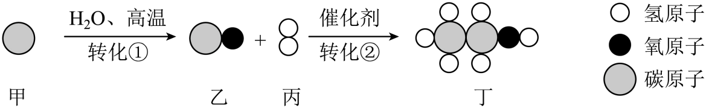

# Chemistry - 题目 261

**ID**: 32b22df7998140fd9d83ac6eae87baf3
**年级**: Grade 9
**难度**: Medium
**题型**: Multiple-choice

## 题目
以物质甲为原料合成化工产品丁的微观过程如图，下列说法不正确的是（      ）​​​​​​​‌

## 解答

1. A、由分析可知，转化①化学方程式为 ${\rm {\rm{C}}{\rm{+}}{\rm{H}}{{}_{2}}{\rm{O}}\hspace{-0.5em}\begin{array}{}{\underline{{\underline{~~高温~~}}}}\atop{}\end{array}\hspace{-0.5em}{\rm{C}}{\rm{O}}{\rm{+}}{\rm{H}}{{}_{2}}}$ ，该反应由一种单质与一种化合物反应，生成另一种单质和另一种化合物，属于置换反应，说法正确，不符合题意；
2. B、由分析可知，乙为一氧化碳、丙为氢气，转化②化学方程式为 ${\rm {\rm{2}}{\rm{C}}{\rm{O}}{\rm{+}}{\rm{4}}{\rm{H}}{{}_{2}}\hspace{-0.5em}\begin{array}{}{\underline{{\underline{~~催化剂~~}}}}\atop{}\end{array}\hspace{-0.5em}{\rm{C}}{{}_{2}}{\rm{H}}{{}_{5}}{\rm{O}}{\rm{H}}{\rm{+}}{\rm{H}}{{}_{2}}{\rm{O}}}$ ，则转化②中乙、丙分子个数比是2∶4=1∶2，说法错误，符合题意；
3. C、由分析可知，转化②化学方程式为 ${\rm {\rm{2}}{\rm{C}}{\rm{O}}{\rm{+}}{\rm{4}}{\rm{H}}{{}_{2}}\hspace{-0.5em}\begin{array}{}{\underline{{\underline{~~催化剂~~}}}}\atop{}\end{array}\hspace{-0.5em}{\rm{C}}{{}_{2}}{\rm{H}}{{}_{5}}{\rm{O}}{\rm{H}}{\rm{+}}{\rm{H}}{{}_{2}}{\rm{O}}}$ ，其中一氧化碳属于无机物，乙醇属于有机物，因此转化②体现了无机物可转化为有机物；说法正确，不符合题意；
4. D、由分析可知，丁为乙醇，乙醇具有杀菌消毒的作用，因此一定浓度的丁溶液可杀灭新冠病毒，说法正确，不符合题意。
5. 故选：B。

## 知识点

**中文**:
  - 化学方程式的意义与信息
  - 置换反应
  - 有机物和无机物的区分
  - 微观反应示意图

**English**:
  - Meaning and Information of Chemical Equations
  - Displacement Reaction
  - Distinction between Organic and Inorganic Substances
  - Microscopic Reaction Diagrams

---
