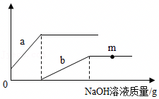

# Chemistry - 题目 29

**ID**: 3719d1086b114afa98bfd3b0140e2ee9
**年级**: Grade 9
**难度**: Medium
**题型**: 选择题（本大题共10小题，每小题4分，共40分，每小题只有一个选项符合要求。）

## 题目
下列说法合理的有（      ）①炼钢用的氧化剂是氧气②打开汽水瓶盖，看到气泡逸出，说明气体的溶解度随压强的减小而减小③向充满CO_{2}气体的软塑料瓶中倒入半瓶水，拧紧瓶盖，振荡，塑料瓶变瘪，说明CO_{2}能溶于水，且能与水发生反应④某同学将一定量的Na_{2}CO_{3}和Ca（OH）_{2}溶液混合，要想检验反应后Ca（OH）_{2}是否过量，选用Na_{2}CO_{3}溶液、CuCl_{2}溶液均可⑤向一定量的NaCl、CuSO_{4}和HCl的混合溶液中逐滴加入NaOH溶液，如图表示加入NaOH溶液的质量与某些物质的质量变化关系。​​​​​​​‌则m点对应的溶液中有三种溶质，a可表示NaCl的质量变化情况

## 解答

1. ①炼钢是将生铁中碳反应，使其含量降低，用的氧化剂是氧气，故正确；
2. ②气体溶解度随压强的减小而减小，故打开汽水瓶盖，看到有气泡冒出，故正确；
3. ③向充满CO_{2}气体的软塑料瓶中倒入半瓶水，拧紧瓶盖，振荡，塑料瓶变瘪，只能说明导致压强改变的可能二氧化碳能与水反应，也可能是二氧化碳溶于水，故错误；
4. ④将一定量的Na_{2}CO_{3}和Ca（OH）_{2}溶液混合发生的反应方程式为Na_{2}CO_{3}+Ca（OH）_{2}＝CaCO_{3}↓+2NaOH，要检验反应后氢氧化钙过量，即要检验溶液中含有钙离子，可加入碳酸钠溶液或硫酸钠溶液，若产生白色沉淀，说明氢氧化钙过量；由于反应后的溶液中含有氢氧化钠，也能与氯化铜反应生成氢氧化铜沉淀，故不能加入氯化铜溶液检验氢氧化钙，故错误；
5. ⑤向一定量的NaCl、CuSO_{4}和HCl的混合溶液中逐滴加入NaOH溶液，中和反应优先发生，因此先发生的反应为NaOH+HCl＝NaCl+H_{2}O，当溶液中HCl被消耗完后，发生的反应为CuSO_{4}+2NaOH＝Cu（OH）_{2}↓+Na_{2}SO_{4}，由图上可知b线表示的物质在加入一定量氢氧化钠后才开始增加，则b线可以表示Cu（OH）_{2}的质量，m点表示氢氧化钠过量，则溶液中含有的溶质为氢氧化钠、硫酸钠、氯化钠；a线表示的物质是在没有加氢氧化钠溶液时溶液中就含有的物质，且在产生氢氧化镁沉淀后质量不在发生改变，由于加入的氢氧化钠溶液中含有水，水的质量会一直增大，故a线只能表示NaCl质量的变化情况，故正确。
6. 故选：C。

## 知识点

**中文**:
  - 二氧化碳与水的反应
  - 气体的溶解度
  - 酸的化学性质
  - 盐的化学性质
  - 工业炼铁

**English**:
  - Reaction of Carbon Dioxide with Water
  - Solubility of Gases
  - Chemical Properties of Acids
  - Chemical Properties of Salts
  - Industrial Iron Smelting

---
