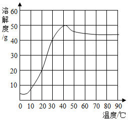

# Chemistry - 题目 81

**ID**: 3a691ddaf2e64dd1961b469849a6a67a
**年级**: Grade 9
**难度**: Medium
**题型**: Multiple-choice

## 题目
如图是固体物质M的溶解度曲线，下列说法中正确的是​​​​​​​‌

## 解答

1. A、20℃时，M物质的溶解度是20g，所以20gM溶解在100g水中形成的是饱和溶液，故A错误；
2. B、高于40℃时，M的溶解度随温度升高而减小，故B错误；
3. C、将50℃时M的饱和溶液升温至80℃，溶解度减小，析出晶体，溶液仍是饱和溶液，故C错误；
4. D、将40℃时M的饱和溶液降温至10℃，溶解度减小，有固体析出，故D正确。
5. 故选D。

## 知识点

**中文**:
  - 溶解度曲线

**English**:
  - Solubility Curve

---
