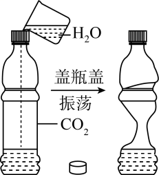
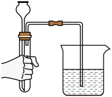
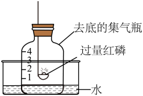
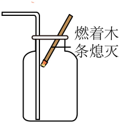

# Chemistry - 题目 223

**ID**: 65be2b56098643f4ab45276bb6116df5
**年级**: Grade 9
**难度**: Medium
**题型**: Multiple-choice

## 题目
下列实验方案能达到实验目的是（      ）选项ABCD实验目的证明CO_{2}可与H_{2}O反应生成H_{2}CO_{3}检验装置的气密性测定空气中氧气的含量证明集气瓶中已充满CO_{2}实验方案​​​​​​​‌

## 解答

1. A、将水倒入充满二氧化碳的塑料瓶中，盖上瓶盖，振荡，塑料瓶变瘪，有可能是二氧化碳溶于水造成的，不能证明二氧化碳与水反应生成碳酸，故选项不能达到实验目的；
2. B、该装置未构成封闭体系，即左边的长颈漏斗与大气相通；无论该装置气密性是否良好，导管口都不会有气泡产生，不能判断气密性是否良好，故选项不能达到实验目的；
3. C、足量的红磷燃烧消耗氧气，装置内压强减少，水槽中的水进入集气瓶，上升至1刻度处，能测定空气中氧气的含量，故选项能达到实验目的；
4. D、检验二氧化碳是否收集满时，应将燃着的木条放在集气瓶口，不能伸入瓶中，故选项不能达到实验目的。
5. 故选C。

## 知识点

**中文**:
  - 一氧化碳与二氧化碳分离和鉴别
  - 燃烧条件与灭火原理探究
  - 不燃烧也不支持燃烧
  - 二氧化碳与水的反应

**English**:
  - Separation and Identification of CO and CO2
  - Inquiry into Combustion Conditions and Extinguishing Principles
  - Non-combustible and Non-supporting Combustion
  - Reaction of Carbon Dioxide with Water

---
