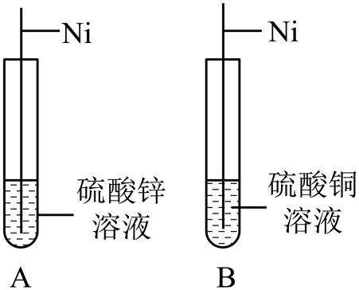

# Chemistry - 题目 232

**ID**: e608e2d1222c448aa57ffe65ba8ea872
**年级**: Grade 9
**难度**: Medium
**题型**: Multiple-choice

## 题目
金属镍在制造钱币、不锈钢、催化剂等方面有着广泛的应用。​​​​​​​‌为探究镍（Ni）、锌、铜的金属活动性顺序，小明做了如图所示的实验，发现A试管中镍丝表面无现象，B试管中镍丝表面出现红色物质，则三种金属活动性由强到弱的顺序是（      ）

## 解答

1. 根据金属活动性顺序的应用可知，排在金属活动性顺序中前面的金属可以把排在后面的金属从其盐溶液里置换出来。据图可知，A试管中镍丝表面无现象，说明镍没有置换出硫酸锌溶液中的锌，镍不如锌活泼；B试管中镍丝表面出现红色物质，说明镍置换出硫酸铜溶液中的铜，镍比铜活泼。所以三种金属活动性由强到弱的顺序是Zn、Ni、Cu。
2. 故选：C。

## 知识点

**中文**:
  - 金属活动性顺序

**English**:
  - Metal Activity Series

---
