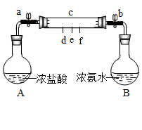

# Chemistry - 题目 187

**ID**: 05032a6b7d614c95ac640803d3f85e37
**年级**: Grade 9
**难度**: Medium
**题型**: Scientific Inquiry

## 题目
小明学习了分子的知识以后，他对分子的运动速率产生了兴趣，所以设计如下实验进行探究。​​​​​​​‌〖问题〗分子运动的快慢与什么因素有关呢？〖猜想和假设〗①与温度有关；②与分子种类有关。探究一：分子运动的快慢与温度有关。〖实验探究〗取相同体积的水，分别加入两个蒸发皿内，一个蒸发皿在酒精灯上加热，另一个露置于空气中，结果发现被加热的蒸发皿中的水蒸发得，而未被加热的蒸发皿中的水几乎无变化。〖结论1〗猜想①正确，分子运动的快慢与温度的关系是。探究二：分子运动的快慢与分子种类有关。〖查阅资料〗浓盐酸易挥发出氯化氢气体，浓氨水易挥发出氨气，氨气与氯化氢气体相遇会产生大量白烟，这是因为两者发生反应生成了氯化铵固体。写出氨气与氯化氢气体发生反应的文字表达式：。〖实验探究〗如图所示，烧瓶A中盛有浓盐酸，烧瓶B中盛有浓氨水，在长玻璃管外壁上用记号笔做了d、e、f三个标记，实验开始时打开弹簧夹a、b，过一会儿玻璃管中产生大量白烟，而且d处白烟最浓厚。〖结论2〗（1）玻璃管中产生大量白烟，此现象能说明分子具有的性质是。（2）猜想正确。〖拓展〗实验室保存浓盐酸等易挥发的物质时，需注意的事项是。

## 解答

1. 探究一：实验探究：取相同体积的水，分别加入两个蒸发皿内，一个蒸发皿在酒精灯上加热，另一个露置于空气中，由于分子在不断运动，温度越高，分子运动的越快，故结果发现被加热的蒸发皿中的水蒸发得很快，而未被加热的蒸发皿中的水几乎无变化；
2. 结论1：被加热的水蒸发的较快，而未被加热的水几乎无变化，说明分子运动的快慢与温度有关，在其它条件相同的情况下，温度越高，分子的运动速率越快；
3. 探究二：查阅资料：氨气与氯化氢反应生成氯化铵，该反应的文字表达式为： $氯化氢+氨气{\mathop {\to }\limits_{}^{}}氯化铵$ ；
4. 实验探究：结论2：（1）玻璃管内产生大量白烟，是因为分子在不断运动，当氯化氢分子和氨气分子相遇时，氯化氢和氨气反应生成氯化铵，形成白烟；
5. （2）d处白烟最浓厚，说明氨分子的运动速率大于氯化氢分子的运动速率，说明分子的运动速率与分子的种类有关，故猜想②正确；
6. 拓展：实验室保存浓盐酸等易挥发的物质时，应密封保存。

## 知识点

**中文**:
  - 实验探究分子的运动

**English**:
  - Experimental Inquiry of Molecular Motion

---
