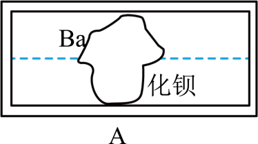

# Chemistry - 题目 244

**ID**: 4b30261b129a4f598ac1180f158f35ac
**年级**: Grade 9
**难度**: Medium
**题型**: Scientific Inquiry

## 题目
在学习盐的性质时，老师带来一瓶标签破损的溶液M如图A所示。​​​​​​​‌以下为酸碱盐溶解性表（室温）的一部分，如表。离子${\rm{O}}{\rm{H}}{^{-}}$NO^{-}${\rm{C}}{\rm{l}}{^{-}}$${\rm{S}}{\rm{O}}{{}_{4}^{2-}}$${\rm{C}}{\rm{O}}{{}_{3}^{2-}}$${\rm{K}}{^{+}}$溶溶溶溶溶${\rm{N}}{\rm{a}}{^{+}}$溶溶溶溶溶${\rm{B}}{\rm{a}}{^{2+}}$溶溶溶不不探究一：溶液M的溶质是什么（1）溶液M的溶质可能是 ${\rm{B}}{\rm{a}}({\rm{O}}{\rm{H}}){{}_{2}}$ 或（用化学式表示）。（2）为了确定溶液M中的溶质，同学们取少量样品于试管中，滴加无色酚酞溶液现象为说明溶液M中的溶质不是 ${\rm{B}}{\rm{a}}({\rm{O}}{\rm{H}}){{}_{2}}$ 。探究二：老师取一定量溶液M与Na_{2}CO_{3}溶液混合，有白色沉淀产生，过滤后得到澄清滤液。【提出问题】滤液中的溶质成分是什么？【猜想与假设】（3）猜想一： ${\rm{N}}{\rm{a}}{\rm{C}}{\rm{l}}$ 、 ${\rm{N}}{\rm{a}}{{}_{2}}{\rm{C}}{\rm{O}}{{}_{3}}$ ；猜想二：NaCl；猜想三：。【实验验证】甲同学进行了如表实验：实验操作实验现象实验结论取样于试管中，加入 ${\rm{C}}{\rm{a}}{\rm{C}}{\rm{l}}{{}_{2}}$ 溶液有白色沉淀产生猜想正确【总结与交流】（4）若要验证甲同学的实验结论，还可以选用的物质有（多选，填字母）。

## 解答

1. （1）硫酸钡、碳酸钡不溶于水，所以溶液M的溶质不能是硫酸钡、碳酸钡。名称为某化钡，则不可能是硝酸钡、硫酸钡、碳酸钡，只可能是氢氧化钡或氯化钡，氯化钡化学式BaCl_{2}；
2. （2）氢氧化钡溶液为碱性，硝酸钡溶液为中性。碱性溶液能使酚酞变红，酚酞在中性、酸性溶液中为无色。所以滴加无色酚酞溶液现象为溶液不变色（或溶液仍为无色），说明溶液M的溶质不是氢氧化钡，是氯化钡。
3. （3）氯化钡和碳酸钠反应生成碳酸钡和氯化钠，所以滤液可能含有氯化钠和过量的反应物。则猜想三：NaCl、BaCl_{2；}
4. 氯化钙和氯化钠、氯化钡不反应。氯化钙和碳酸钠反应生成碳酸钙沉淀和氯化钠，所以猜想一正确。
5. （4）A、硝酸钡和氯化钠、氯化钡不反应，和碳酸钠反应生成碳酸钡白色沉淀，可以检验是否有碳酸钠；
6. B、氯化钾和氯化钠、氯化钡、碳酸钠都不反应，不能检验是否有碳酸钠。
7. C、稀盐酸和氯化钠、氯化钡不反应。碳酸钠和盐酸反应生成氯化钠、水和二氧化碳，有气泡产生，可以检验是否有碳酸钠；
8. D、氢氧化钙和氯化钠、氯化钡不反应，和碳酸钠反应生成碳酸钙白色沉淀，可以检验是否有碳酸钠。

## 知识点

**中文**:
  - 碱的化学性质
  - 缺失标签的药品成分的探究
  - 酸碱指示剂

**English**:
  - Chemical Properties of Bases
  - Inquiry into Composition of Unlabeled Reagents
  - Acid-Base Indicators

---
