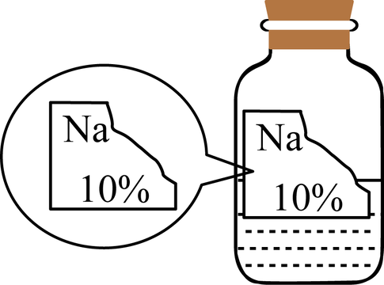

# Chemistry - 题目 28

**ID**: 9b586be0962647318cef539b57c0066c
**年级**: Grade 9
**难度**: Medium
**题型**: Scientific Inquiry

## 题目
实验室有一瓶标签残缺并且瓶盖没有完全密封的无色溶液(如下图)，化学小组的同学经过询问老师后只知道是NaCl、NaOH、Na_{2}CO_{3}、NaHCO_{3}中的一种溶液，为确认原瓶中是何种溶质并判断其是否变质，化学小组的同学进行了如下的探究活动：【进行猜想】猜想I：原溶液的溶质是NaCl；猜想II：原溶液的溶质是NaOH；猜想III：原溶液的溶质是Na_{2}CO_{3}；猜想IV：原溶液的溶质是NaHCO_{3}。​​​​​​​‌【查阅资料】常温下，有关物质的相关信息如下表：物质NaClNaOHNa_{2}CO_{3}NaHCO_{3}常温下的溶解度/g3610921.59.6常温下稀溶液的pH713119（1）常温下，将10g NaHCO_{3}固体加入100g水中，所得溶液为(填“饱和”或“不饱和”)状态，所得溶液中溶质的质量分数为(填计算式)。（2）通过以上推算，结合残缺标签信息，原溶液的溶质(“可能”或“不可能”)是NaHCO_{3}。【进行实验】（3）取少量样品，测得溶液的pH大于7，则原溶液的溶质肯定不是。同学们另取样品又进行了如下实验，实验过程如下：（4）生成白色沉淀A的化学方程式。（5）通过实验可以判断样品无色溶液中含有的溶质有。【获得结论】（6）实验完成后，最终得到的结论：原瓶中的溶质是，且已变质。

## 解答

1. （1）由表中数据可知，常温下，NaHCO_{3}的溶解度是9.6g，即100g水最多溶解9.6g NaHCO_{3}，所以常温下，将10g NaHCO_{3}固体加入100g水中，所得溶液为饱和溶液；所得溶液中溶质的质量分数为： $\frac {{{9}}{{.}}{{6}}{\rm{g}}}{{{9}}{{.}}{{6}}{\rm{g}}{{+}}{{1}}{{0}}{{0}}{\rm{g}}}\times 100\%$ ；
2. （2）常温下，NaHCO_{3}的溶解度是9.6g，饱和碳酸氢钠的质量分数为： $\frac {{{9}}{{.}}{{6}}{\rm{g}}}{{{9}}{{.}}{{6}}{\rm{g}}{{+}}{{1}}{{0}}{{0}}{\rm{g}}}{\rm ×100}$ %=8.8%＜10%，所以能够排除碳酸氢钠；
3. （3）测定溶液的pH大于7，而氯化钠溶液呈中性，pH等于7所以不可能是氯化钠；
4. （4）过量的氯化钙可以检验并除尽碳酸钠，碳酸钠可以和氯化钙反应生成碳酸钙沉淀和氯化钠，产生白色沉淀的化学方程式是Na_{2}CO_{3}+CaCl_{2}=CaCO_{3}↓+2NaCl；
5. （5）滴加无色酚酞，滤液变红，说明溶液呈碱性，还有氢氧化钠，实验可以判断原无色溶液中含有的溶质有NaOH、Na_{2}CO_{3}；
6. （6）通过实验可以判断样品无色溶液中含有的溶质有NaOH、Na_{2}CO_{3}，即氢氧化钠溶液部分变质。

## 知识点

**中文**:
  - 实验探究物质的组成成分以及含量
  - 碱的化学性质
  - 盐的化学性质

**English**:
  - Inquiry into Composition and Content of Matter
  - Chemical Properties of Bases
  - Chemical Properties of Salts

---
