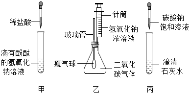

# Chemistry - 题目 95

**ID**: cc6414f4bb864819ba300a1e18f89760
**年级**: Grade 9
**难度**: Medium
**题型**: Scientific Inquiry

## 题目
同学们在学习碱的化学性质时，进行了如图所示的实验。​​​​​​​‌实验结束后，同学们将甲、乙、丙三个实验的废液倒入同一个干净的废液缸中，最终看到废液浑浊并呈红色，产生疑问。〖提出问题〗 废液中含有哪些物质？〖交流讨论〗①一定含有的物质：碳酸钙、指示剂、水和（写物质名称） 。②还含有能使废液呈碱性的物质。能使废液呈碱性的物质是什么？同学们有如下猜想。小云认为：只有碳酸钠小红认为：只有氢氧化钙_{ }小林认为：是氢氧化钠和碳酸钠你认为还可能是。(写一种猜想)〖实验设计〗小方想用氯化钙溶液来验证小云、小红、小林的猜想。查阅资料获悉氯化钙溶液呈中性，并设计如下实验。请你将小方的实验设计补充完整。实验内容预计现象预计结论取少量废液缸中上层清液于试管中，加入过量氯化钙溶液，静置。①有白色沉淀，溶液呈无色小云的猜想正确②无白色沉淀，溶液呈红色小红的猜想正确③。小林的猜想正确〖反思拓展〗在分析化学反应后所得物质的成分时，除了考虑生成物外还需考虑。

## 解答

1. 交流讨论：①由于稀盐酸与氢氧化钠反应生成了氯化钠和水，所以，一定含有的物质不仅有碳酸钙、指示剂、水，还有NaCl，故填：氯化钠；
2. ②碱性物质能使酚酞变红色，废液呈红色，说明废液显碱性，碳酸钠和氢氧化钙反应生成碳酸钙沉淀和氢氧化钠，故废液中还有可能含有氢氧化钠，故填：NaOH或氢氧化钠；
3. 实验设计：氯化钙能与碳酸钠反应生成碳酸钙沉淀和氯化钠，生成物不呈碱性，若有白色沉淀，溶液呈无色，说明溶液中只含有碳酸钠，则小云的猜想正确；若没有白色沉淀，溶液呈红色，说明溶液中只含有氢氧化钠，则小红的猜想正确；若有白色沉淀，溶液呈红色，则说明溶液中还有碱性物质存在，即溶液中含有氢氧化钠和碳酸钠，故小林的猜想正确，故填：有白色沉淀，溶液呈红色；
4. 反思拓展：在分析化学反应后所得物质的成分时，除了考虑生成物外还需考虑反应物是否有剩余，故填：反应物是否有剩余。

## 知识点

**中文**:
  - 实验探究物质的组成成分以及含量
  - 科学探究的基本方法

**English**:
  - Inquiry into Composition and Content of Matter
  - Basic Methods of Scientific Inquiry

---
