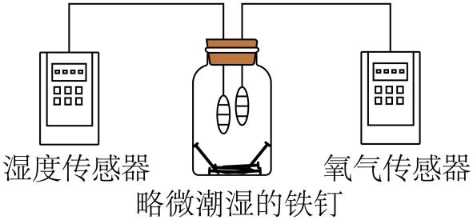

# Chemistry - 题目 38

**ID**: e770a6facd76423caa3d350aff8f0d9f
**年级**: Grade 9
**难度**: Medium
**题型**: Scientific Inquiry

## 题目
某兴趣小组开展了“钢铁锈蚀的条件及其防护方法”的研究性课题。​​​​​​​‌【证据推理】(1)按如图进行实验，观察到铁钉表面生锈，同时湿度传感器的读数变（填“大”或“小”，下同），氧气传感器读数变，从而得出钢铁生锈的条件。【查阅资料】①钢铁膜化处理是钢铁防护的重要方法，其目的是在钢铁表面形成致密、均匀的保护膜。②检验膜的抗腐蚀性能要做“滴铜实验”，即往钢铁表面滴加含硫酸铜的腐蚀剂，若60s后钢铁表面才出现红色物质，则表明抗腐蚀性能达标，且越迟出现红色物质，抗腐蚀性能越好。【进行实验】I.验证膜的抗腐蚀性能。【实验1】将有膜化和未膜化的薄钢片分别进行滴铜实验。(2)用化学方程式表示，出现红色物质的原因是。(3)有膜化的薄钢片出现红色物质的时间明显推迟，其原因是。II.探究膜化条件对膜层外观的影响【实验2】在其他条件相同时，将薄钢片放入pH=3、不同温度的膜化剂中浸泡20min，观察钢片表面形成的膜层外观。结果如下表：温度/℃50607080膜层外观粗糙致密、均匀致密、均匀粗糙【实验3】在其他条件相同时，将薄钢片放入60℃、不同pH的膜化剂中浸泡20min，观察钢片表面形成的膜层外观。结果如下表：pH1.52.02.53.0膜层外观易脱落粗糙致密、均匀致密、均匀(4)实验3的目的是。(5)根据实验2、实验3的结果，形成符合要求的膜层外观所需温度、pH的范围依次为、。III.确定抗腐蚀性能较好的膜化条件【实验4】选取实验2、实验3膜层外观符合要求的钢片进行对比实验，分别确定最佳的温度、pH。(6)实验4中，确定最佳温度的实验方案是：分别取60℃和70℃膜化好的钢板，进行滴铜实验，观察记录的时间。

## 解答

1. （1）铁生锈实际上是铁与空气中的氧气和水共同作用的结果，则该实验中观察到铁钉表面生锈，同时湿度传感器的读数变小，氧气传感器读数变小，从而得出钢铁生锈的条件；
2. （2）出现红色物质的原因是钢片中含有铁，铁能与硫酸铜反应生成铜和硫酸亚铁，化学方程式为 ${\rm{F}}{\rm{e}}{{+}}{\rm{C}}{\rm{u}}{\rm{S}}{\rm{O}}{{}_{{{4}}}}\hspace{-0.5em}\begin{array}{}{\underline{{\underline{~{\,}{\,}{\,}{\,}{\,}{\,}~}}}}\atop{}\end{array}\hspace{-0.5em}{\rm{F}}{\rm{e}}{\rm{S}}{\rm{O}}{{}_{{{4}}}}{{+}}{\rm{C}}{\rm{u}}$ ；
3. （3）有膜化的薄钢片出现红色物质的时间明显推迟，说明加入的含硫酸铜的腐蚀剂与铁接触到需要较长时间，但最终接触到，则其原因可能是腐蚀剂将致密保护膜破坏需要一定的时间；
4. （4）实验3中，其他条件相同时，将薄钢片放入不同pH的膜化剂中浸泡，观察钢片表面形成的膜层外观，变量是pH，则实验目的是探究相同条件下不同pH的膜化剂对钢片表面形成的膜层外观影响；
5. （5）从实验2、3结果可知，温度为60℃、70℃时膜层外观是致密、均匀的，pH为2.5、3.0时膜层外观是致密、均匀的，所以膜层外观符合要求的温度、 ${\rm{p}}{\rm{H}}$ 的范围依次为60℃~70℃、2.5~3.0；
6. （6）由题干信息可知，检验膜的抗腐蚀性能要做“滴铜实验”，即往钢铁表面滴加含硫酸铜的腐蚀剂，若60s后钢铁表面才出现红色物质，则表明抗腐蚀性能达标，且越迟出现红色物质，抗腐蚀性能越好；则实验4中，确定最佳温度的实验方案是分别取60℃和70℃膜化好的钢板，进行滴铜实验，观察记录钢片表面从滴入腐蚀剂到开始出现红色物质的时间。

## 知识点

**中文**:
  - 探究金属锈蚀的条件
  - 探究铁生锈的条件
  - 金属的防锈措施

**English**:
  - Investigating Conditions for Metal Corrosion
  - Investigating Conditions for Iron Rusting
  - Anti-rust Measures for Metals

---
