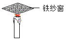
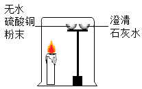

# Chemistry - 题目 316

**ID**: ec4fbc6fd83f4f50a36a0976a47f9bfb
**年级**: Grade 9
**难度**: Medium
**题型**: Scientific Inquiry

## 题目
英国科学家法拉第著有《蜡烛的化学史》，化学兴趣小组的同学们沿着大师的足迹，对蜡烛及其燃烧进行再次探究。​​​​​​​‌〖资料〗无水硫酸铜粉末为白色，无水硫酸铜粉末遇水变蓝色。〖实验〗序号操作现象结论（1）取一支蜡烛，用指甲刻画蜡烛（2）用小刀切一小块蜡烛投入水中蜡块浮于水面，形状无明显变化（3）观察到外焰处的铁纱窗出现红热的环，内焰及焰心处的铁纱窗无明显变化（4）蜡烛燃烧有水和二氧化碳生成在点燃蜡烛时，小敏发现有一根烛芯沾有食盐的蜡烛比普通蜡烛燃烧的时间长一些。于是小组同学继续探究：〖提出问题〗食盐是否能延长蜡烛的燃烧时间？〖猜想〗食盐可延长蜡烛的燃烧时间。〖实验探究〗取6支相同的蜡烛，在其中5支的烛芯周围分别放入不同量的食盐，另1支作对照实验，分别测定它们的燃烧时间。〖实验结果〗食盐质量（g）00.10.50.70.91.0燃烧时间（分钟）101518232527燃烧稳定性正常正常正常正常易灭极易灭〖实验结论〗〖实验反思〗实验中需控制所用6支蜡烛相同，其目的是。

## 解答

1. 实验：（1）用指甲刻画蜡烛，蜡烛表面能留下划痕，说明蜡烛质软。
2. （2）蜡块投入水中，形状无明显变化，说明蜡块难溶于水，蜡块浮于水面，说明蜡块的密度比水小。
3. （3）外焰处的铁纱窗出现红热的环，内焰及焰心处的铁纱窗无明显变化，说明蜡烛火焰中，外焰温度比内焰和焰心的都高。
4. （4）无水硫酸铜遇水变蓝色，蜡烛燃烧有水生成，所以实验中，无水硫酸铜会变蓝色，二氧化碳能使澄清石灰水变浑浊，蜡烛燃烧有二氧化碳生成，所以可观察到澄清石灰水变浑浊。
5. 实验结论：根据实验结果，可知加入食盐后，蜡烛燃烧时间变长了，因此猜想正确或食盐可延长蜡烛燃烧时间。
6. 实验反思：本实验是探究加入食盐能否延长蜡烛燃烧的时间，因此需防止其他因素对蜡烛燃烧时间的影响，所以实验中控制所用6支蜡烛相同的目的是控制变量唯一。

## 知识点

**中文**:
  - 蜡烛燃烧

**English**:
  - Combustion of a Candle   [Image of Candle combustion experiment] 

---
