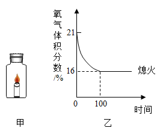

# Chemistry - 题目 256

**ID**: 516a6e60e19242988984b8658990aadc
**年级**: Grade 9
**难度**: Medium
**题型**: Short Answer

## 题目
将燃着的蜡烛放在甲图所示的密闭容器中，同时用氧气传感器测出密闭容器中氧气含量的变化如图乙所示。​​​​​​​‌(1)蜡烛燃烧时，密闭容器中氧气的体积分数为。(2)蜡烛熄灭的原因是。

## 解答

1. （1）由图可知，氧气的浓度低于16%时熄灭，空气中氧气的体积分数是21%，故密闭容器中氧气的体积分数为16-21%。
2. （2）蜡烛燃烧耗掉瓶中的部分氧气，使氧气的浓度太小，故蜡烛不能正常燃烧。

## 知识点

**中文**:
  - 测定空气中氧气含量

**English**:
  - Measuring Oxygen Content in Air

---
