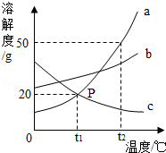

# Chemistry - 题目 35

**ID**: 65121edb6bef431a8f143516d94ddef6
**年级**: Grade 9
**难度**: Medium
**题型**: Short Answer

## 题目
下图是a、b、c三种物质的溶解度曲线，a与c的溶解度曲线相交于P点．据图回答：（1）t_{2}℃时30g a物质加入到50g水中不断搅拌，形成的溶液中溶质的质量分数是．（2）t_{2}℃时a、b、c三种物质的溶解度按由小到大的顺序排列是（填写物质序号）．（3）在t_{2}℃时，将等质量的a、b、c三种物质的饱和溶液同时降温至t_{1}℃时，析出晶体最多的是．​​​​​​​‌

## 解答

1. （1）t_{2}℃时，a的溶解度为50g，则30g a物质加入到50g水中不断搅拌，形成饱和溶液，溶质的质量分数为 $\frac {{\rm{5}}{\rm{0}}{\rm{g}}}{{\rm{5}}{\rm{0}}{\rm{g}}{\rm{+}}{\rm{1}}{\rm{0}}{\rm{0}}{\rm{g}}}\times {\rm{1}}{\rm{0}}{\rm{0}}{\rm{\%}}{\rm{=}}{\rm{3}}{\rm{3}}{\rm{.}}{\rm{3}}{\rm{\%}}$ 。
2. （2）依据溶解度曲线 图知：t_{2}℃时a、b、c三种物质的溶解度按由小到大的顺序排列是c＜b＜a
3. （3）a、b、c三种物质的溶解度受温度影响，a最大。B较小，c随温度升高而减小，故在t_{2}℃时，等质量的a、b、c三种物质的饱和溶液同时降温至t_{1}℃时，析出晶体最多的是a。

## 知识点

**中文**:
  - 溶解度曲线

**English**:
  - Solubility Curve

---
