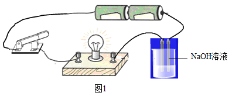
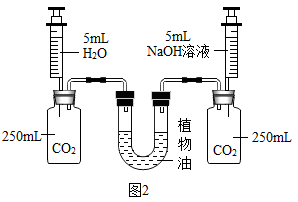
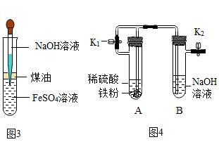

# Chemistry - 题目 150

**ID**: 88292081d2d84dd8953c71b865a2e6b9
**年级**: Grade 9
**难度**: Medium
**题型**: Short Answer

## 题目
氢氧化钠是重要的化工原料。​​​​​​​‌某同学对氢氧化钠的性质进行了如下探究：(1)取NaOH溶液连入图1电路中，闭合开关后，小灯泡发光，说明NaOH溶液具有导电性，NaOH以（填“分子”或“离子”）形式分散在水中。(2)按图2所示进行实验，将H_{2}O和NaOH溶液同时全部注入集气瓶中，观察到U形管内液面（“左端液面上升”或“右端液面上升”），说明CO_{2}和NaOH可以发生反应。(3)探究NaOH溶液和FeSO_{4}溶液的反应〖进行实验1〗该同学将NaOH溶液滴入盛有FeSO_{4}溶液的试管中，观察到有白色沉淀生成，短时间内即变为红褐色。〖查阅资料〗FeSO_{4}+2NaOH=Na_{2}SO_{4}+Fe(OH)_{2}↓（白色）；Fe(OH)_{2}容易被氧气氧化：4Fe(OH)_{2}+O_{2}+2H_{2}O=4Fe(OH)_{3}（红褐色）。〖提出问题〗如何使白色沉淀长时间存在？〖进行实验2〗改进实验装置如图3所示，观察到白色沉淀存在时间较长。〖交流反思1〗装置中煤油的作用是。〖发现问题〗上述白色沉淀放置一段时间后，又转化为红褐色沉淀。〖进行实验3〗分析原因后，再次改进实验装置如图4所示，打开止水夹K_{1}、K_{2}；一段时间后，关闭K_{1}，具支试管B中出现白色沉淀，待液面稳定后关闭K_{2}，所得白色沉淀能保持更长时间。〖交流反思2〗①具支试管A中发生反应的化学方程式为。②H_{2}的作用有：（合理即可）。〖归纳总结〗NaOH水溶液能导电，能与非金属氧化物、酸和盐等物质发生反应。

## 解答

1. (1)
2. 分子不导电，氢氧化钠溶于水后形成自由移动的钠离子和氢氧根离子，因而具有导电性。
3. (2)
4. 氢氧化钠具有碱性，可吸收酸性气体二氧化碳，因此将水和氢氧化钠溶液同时全部注入集气瓶中，右侧集气瓶内气体急剧减少，压强急剧降低，右端液面上升，说明CO_{2}和NaOH可以发生反应；
5. (3)
6. 交流反思1：
7. 煤油不溶于水，且密度比水小，在硫酸亚铁溶液中加入煤油，可起到隔绝氧气的作用，避免氢氧化亚铁与空气接触转化为氢氧化铁；
8. 交流反思2：
9. ①装置A中发生的是铁与稀硫酸反应生成硫酸亚铁和氢气的反应，反应的化学方程式是：Fe+H_{2}SO_{4}=FeSO_{4}+H_{2}↑；
10. ②排出装置内溶液中溶解的氧气，防止氢氧化亚铁被氧化。

## 知识点

**中文**:
  - 探究酸碱的主要性质

**English**:
  - Investigating Properties of Acids and Bases

---
