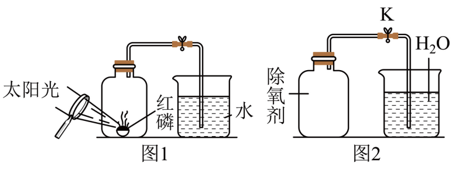
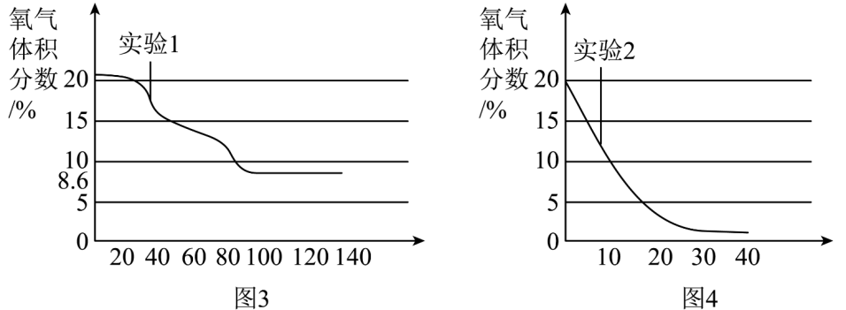
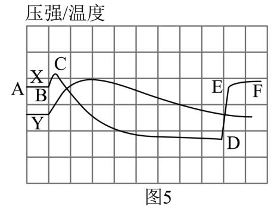

# Chemistry - 题目 294

**ID**: e07e36137b58439eac84b8f3ba9b0ba4
**年级**: Grade 9
**难度**: Medium
**题型**: 未知

## 题目
根据混合物中某组分发生化学反应，测定混合物中某组分的含量是一种非常重要的思维方法，兴趣小组的同学分别用图1、图2装置进行了测定空气中氧气含量的实验。​​​​​​​‌实验1：按图1所示装置，用红磷燃烧的方法测定空气中氧气的体积分数。实验2：按图2所示装置，在集气瓶内壁用水均匀涂附铁粉除氧剂(其中辅助成分不会干扰实验)，利用铁锈蚀原理测定空气中氧气的体积分数(铁锈蚀消耗氧气，且不产生气体)。（1）图1中，若实验进行前在集气瓶中加入15mL的水，集气瓶的容积是250mL，实验结束后理论上集气瓶中水的体积约为(氧气的体积分数按20%计算)。该实验同时也说明了氮气具有的化学性质是。（2）连接数字传感器，测得实验1、实验2中氧气的体积分数随时间变化的关系分别如图3、图4所示，依据图中信息判断，测定空气中氧气含量用作为耗氧剂测定结果误差较小，判断依据是。（3）按照图2进行实验，测得实验过程中装置内压强及温度的变化曲线如图5，压强对应的曲线是(填“X”或“Y”)。

## 解答

1. （1）集气瓶容积为 $250{\rm mL}$ ，实验前加入 $15{\rm mL}$ 水，空气体积为 $250{\rm mL}-15{\rm mL}=235{\rm mL}$ ，氧气占空气体积的 $20\%$ ，则消耗的氧气体积为 $235{\rm mL}\times 20\%=47{\rm mL}$ ，实验结束后，进入集气瓶的水的体积等于消耗的氧气体积，因此最终水的体积约为 $15{\rm mL}+47{\rm mL}=62{\rm mL}$ ；
2. 红磷燃烧后氮气未参与反应，说明氮气不燃烧也不支持燃烧的化学性质。
3. 故填： $62{\rm mL}$ ；不燃烧也不支持燃烧。
4. （2）测定空气中氧气含量用铁粉除氧剂（实验 2 的耗氧剂）误差较小；
5. 依据是：从图3、图4可知，实验2中氧气的体积分数最终几乎为0，而实验1中氧气还有剩余（体积分数约为 $8.6\%$ ），说明铁粉除氧剂能更彻底地消耗氧气，因此误差更小。
6. 故填：铁粉除氧剂；从图3、图4可知，实验2中氧气的体积分数最终几乎为0，而实验1中氧气还有剩余（体积分数约为 $8.6\%$ ），说明铁粉除氧剂能更彻底地消耗氧气，因此误差更小。
7. （3）铁锈蚀消耗氧气，装置内气体减少，压强逐渐减小；同时铁锈蚀是缓慢氧化，放热不明显，温度变化对压强影响小。最终打开止水夹，水进入装置，压强回升。因此压强对应的曲线是Y（曲线Y先减小，后因注水回升，符合实验过程的压强变化）。
8. 故填：Y。

## 知识点

**中文**:
  - 测定空气中氧气含量
  - 测定空气中氧气含量的装置改进

**English**:
  - Measuring Oxygen Content in Air
  - Apparatus Improvement for Measuring Oxygen Content

---
